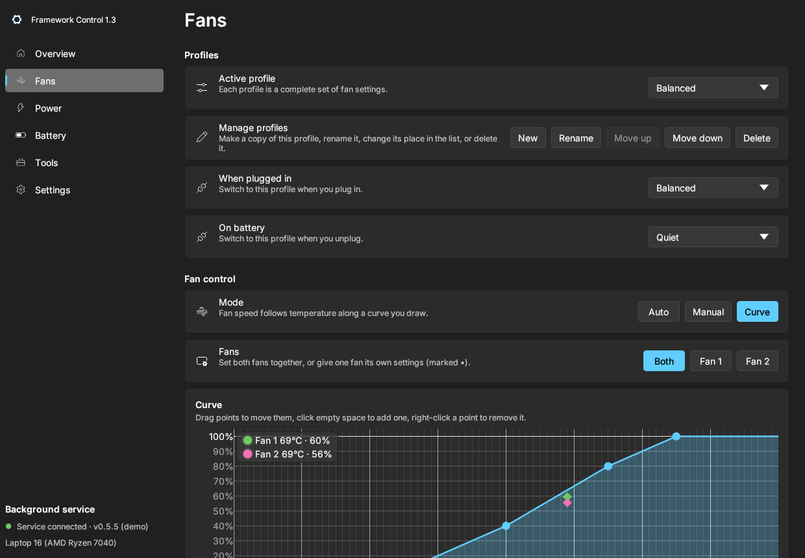
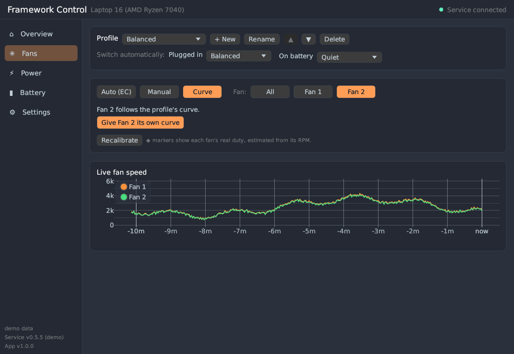
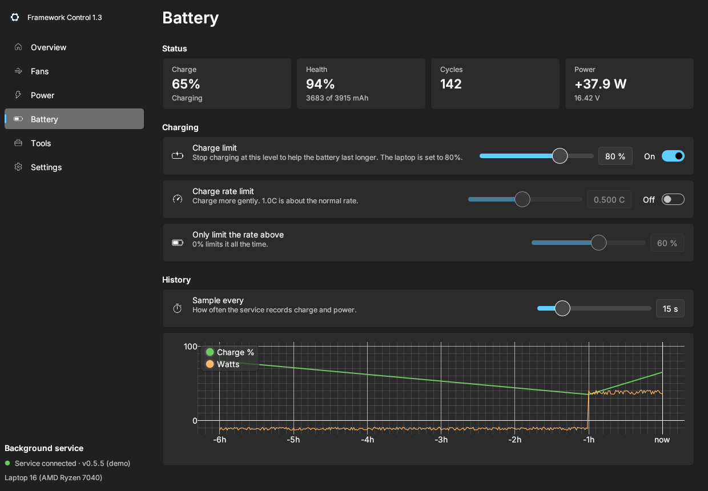
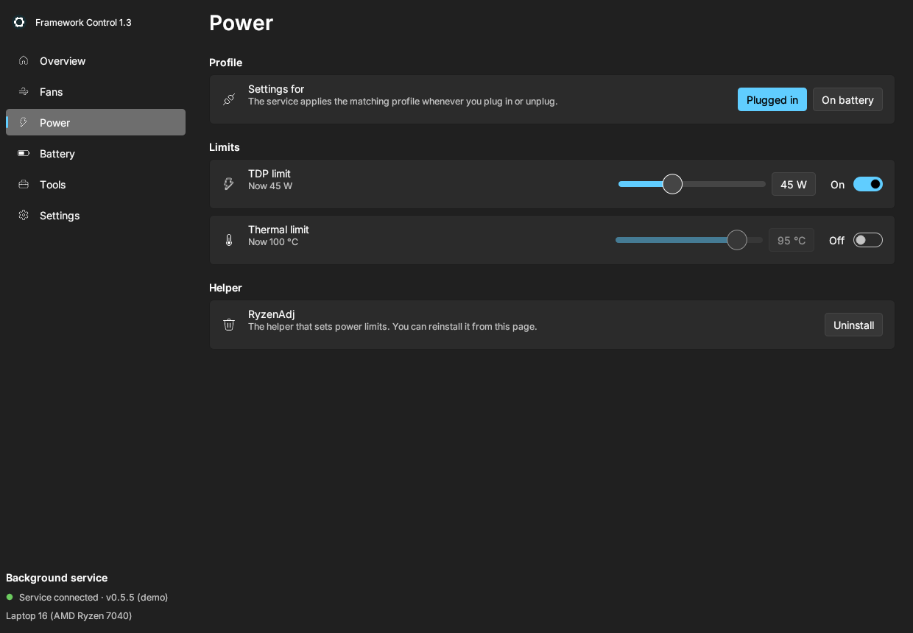
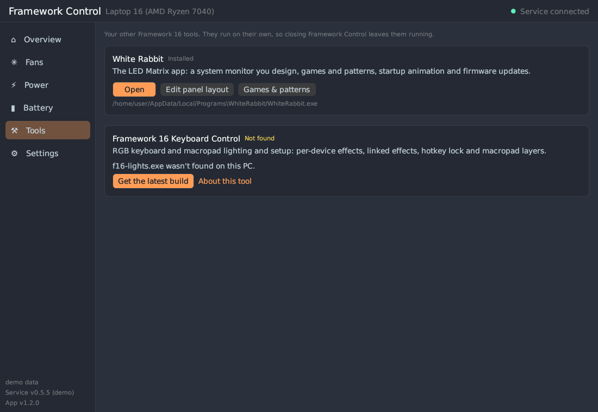
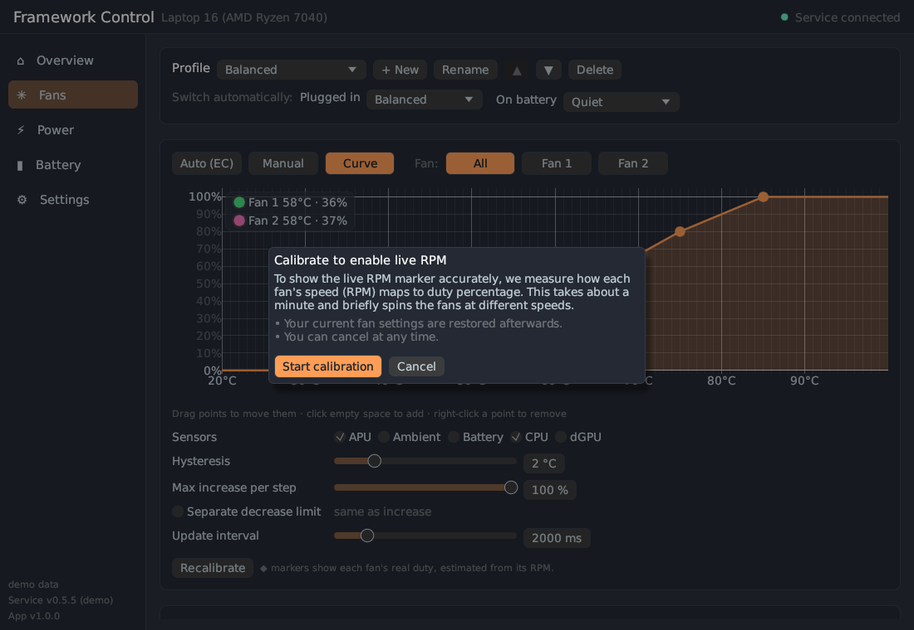
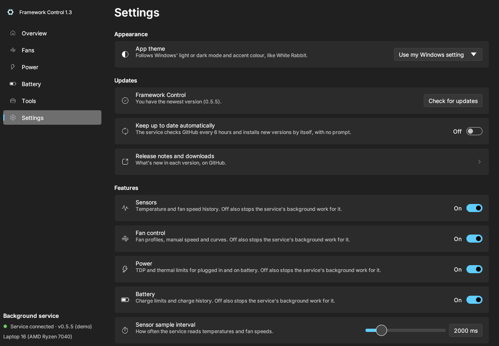

# Framework Control for Windows

A lightweight native Windows app for controlling your Framework laptop: fan
curves, power limits, battery charging, and live temperatures. It's also a
launcher for your other Framework 16 tools. No browser needed.

Built on [**Framework Control**](https://github.com/ozturkkl/framework-control)
by Kemal Ozturk, which provides the background service that talks to the
laptop's hardware. This app is a native Windows front end for it.

**[⬇ Download the latest installer](https://github.com/kingof9x/framework-control-windows-naitive/releases/latest)**
(`FrameworkControl-<version>-x64.msi`)


## Light on resources

The app is a single 5.6 MB executable, written in Rust with
[egui](https://github.com/emilk/egui). It only redraws when new readings
arrive or when you interact with it, and closing the window stops it
entirely. Your fan curves and power limits keep being applied in the
background.

Compared with running the same controls as a web page in Chrome/Edge app mode:

| | This app | Web UI in Chromium app mode |
|---|---|---|
| Memory (PSS, all processes) | **104 MB**, of which ~67 MB was the software GPU driver | 491 MB |
| Processes | **1** | 10 |
| CPU time while idle, 30 s | **1.3 s** | 3.6 s |
| Browser required | **No** | Chrome or Edge |

**About 4.7× less memory, 10× fewer processes, about 2.8× less idle CPU.**

<sub>How this was measured: both UIs showed the same live service on the same
machine (Linux, 1100×760 window, software OpenGL renderer since there was no
GPU), with memory summed as PSS across each UI's process tree. On a real
Windows laptop the GPU driver replaces the ~67 MB software renderer, so the
app's own footprint is closer to 30–40 MB. Absolute numbers will vary; the
ratio is the point. The background service is the same in both setups and
isn't counted.</sub>

## Features

- **Sensors**: live temperature and fan RPM graphs, with a sensor filter and
  an adjustable sample interval.
- **Fans**:
  - Auto (EC), Manual and Curve modes.
  - Drag-to-edit curve: click to add points, right-click to remove.
  - Hysteresis, plus separate up and down rate limits.
  - Per-fan overrides.
  - Live duty markers once the fans are calibrated; the calibration wizard is
    built in.
- **Fan profiles**: create, rename, reorder and delete profiles, and switch
  automatically when you plug in or go on battery.
- **Power**: separate plugged-in and on-battery profiles with TDP and thermal
  limits. The RyzenAdj helper these need installs in one click from the app.
- **Battery**: charge limit, charge-rate limit with an SoC threshold, health,
  cycles, live power, and up to 7 days of history.
- **Tools**: launch your other Framework 16 tools:
  - the [LED Matrix Monitor](https://github.com/kingof9x/led-matrix): start
    it, or open its layout editor;
  - the [keyboard + macropad lighting app](https://github.com/kingof9x/framework-16-keyboard-customization).

  The page shows whether each tool is installed or running, and links to the
  download when it isn't.
- **Settings**: automatic updates, 8 themes, turning features on or off (this
  also stops their background work), `framework_tool` version switching, the
  service log viewer, and device info.

## Screenshots

| Fans: curve editor with live duty markers | Per-fan overrides |
|---|---|
|  |  |
| **Battery: charge limits and history** | **Power: TDP and thermal limits** |
|  |  |
| **Tools: launch your other Framework 16 tools** | **Calibration wizard** |
|  |  |
| **Settings: updates, themes, framework_tool** | **Light theme** |
|  |  |

## Install

1. Download `FrameworkControl-<version>-x64.msi` from the
   [latest release](https://github.com/kingof9x/framework-control-windows-naitive/releases/latest)
   and run it.
2. Open **Framework Control** from the Start Menu or Desktop.

The installer sets up the background service and the app, with Start Menu and
Desktop shortcuts. If you already have the original Framework Control
installed, this replaces it and keeps your settings.

Windows may show a SmartScreen warning because the installer isn't
code-signed. Choose **More info → Run anyway**.

> ⚠️ **Framework 16:** BIOS 3.07 or newer is required for proper EC/fan control.
> Install the [latest BIOS](https://knowledgebase.frame.work/en_us/framework-laptop-16-bios-and-driver-releases-amd-ryzen-7040-series-BkeqkVovp) first.

Each release also includes `framework-control-app-<version>-x64.zip`, the app
on its own. It works with any running Framework Control service, including an
install of the original project.

### Updates

**Settings → Updates** checks this repository's
[releases](https://github.com/kingof9x/framework-control-windows-naitive/releases)
for a newer version. **Install** updates silently, without a UAC prompt, and
keeps your settings. Turn on **Automatically keep up to date** to have new
versions installed by themselves (checked every 6 hours). A badge in the app's
header also shows when an update is available.

### Uninstall

Uninstall **Framework Control** from Settings → Apps. This removes the
service, the app, the shortcuts and the saved settings.

## How it works

```
┌──────────────────────────┐   HTTP on 127.0.0.1   ┌────────────────────────────┐
│ Framework Control app    │ ────────────────────▶ │ Framework Control service  │
│ native UI (Rust + egui)  │                       │ Windows service (SYSTEM)   │
│ only runs while open     │ ◀──────────────────── │ fan curves, power limits,  │
└──────────────────────────┘     JSON + config     │ battery, telemetry history │
                                                   └─────────────┬──────────────┘
                                                                 │ framework_tool / RyzenAdj
                                                                 ▼
                                                      Embedded controller / CPU
```

| Folder | What's there |
|---|---|
| `native/` | This app. API calls happen on a background thread, so the window never blocks, and edits save automatically. |
| `native/installer/` | The WiX MSI definition and `build-msi.ps1`. |
| `service/` | The background service from the original Framework Control project, with two small changes: update checks follow this repository's releases, and versions are compared numerically. |
| `web/` | The original project's browser UI. It isn't shipped; it's kept as the reference for feature parity. |
| `tools/parity/` | Keeps this app in step with the original project (see below). |

## Built on Framework Control

All the hardware control comes from
[**Framework Control**](https://github.com/ozturkkl/framework-control) by
[Kemal Ozturk](https://github.com/ozturkkl): the background service, the fan
curve and power logic, and the feature design. It ships a browser-based UI and
also supports Linux; head there for the Linux version or the web UI.

This app follows that project as it adds features.
[`tools/parity/parity.toml`](tools/parity/parity.toml) maps every feature of
the original UI to its place in this app. The few deliberate omissions are
browser-only features, and each has a note explaining why. To pull in new
upstream changes:

```bash
python3 tools/parity/parity.py upstream   # what changed upstream since the last sync, and what isn't covered yet
python3 tools/parity/parity.py check      # fails if any upstream endpoint, component or setting is unaccounted for
python3 tools/parity/parity.py mark-synced
```

CI runs `check` on every push. The full sync process is in the
[`upstream-parity` skill](.claude/skills/upstream-parity/SKILL.md); in Claude
Code, just ask it to "sync with upstream".

If you find Framework Control useful, please
[support the original project](https://github.com/ozturkkl/framework-control).

## Building from source

Requirements: Rust stable (MSVC on Windows). For the MSI, you also need WiX
Toolset v3 (`choco install wixtoolset`).

```bash
cd native
cargo run --release -- --demo     # sample data, no service or Framework laptop needed
cargo run --release               # connect to the local service (port from the install, $FRAMEWORK_CONTROL_PORT, or 8090)
cargo test
```

```powershell
pwsh native/installer/build-msi.ps1   # -> native/dist/FrameworkControl-<version>-x64.msi
```

Releases: bump `version` in `native/Cargo.toml` and add an entry to
`native/CHANGELOG.md`. Merging to `main` builds the MSI and publishes the
GitHub release ([workflow](.github/workflows/native-release.yml)). See
[`native/README.md`](native/README.md) for the app's internals.

## License and disclaimer

MIT licensed (see [LICENSE](LICENSE)), like the original project.

This software is provided "as is", without warranty of any kind, express or
implied. By using it, you acknowledge that you are responsible for any
configuration changes you make to your system and accept all risks associated
with its use. The authors and contributors are not liable for any damage, data
loss, hardware wear, unintended behavior, or other harm that may result from
use or misuse of this application.
