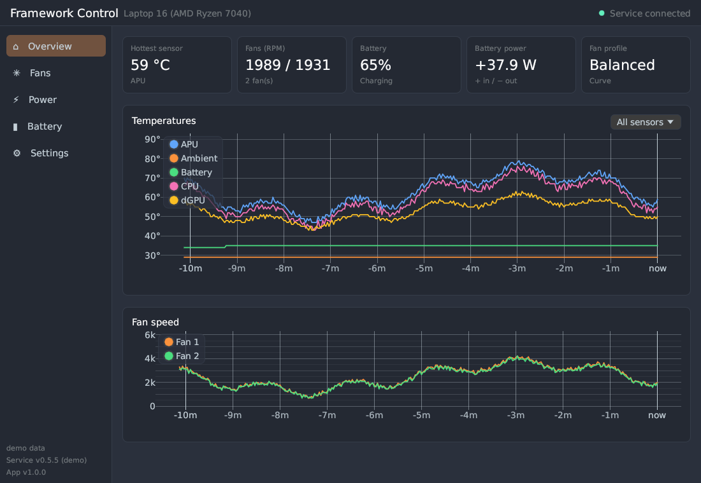
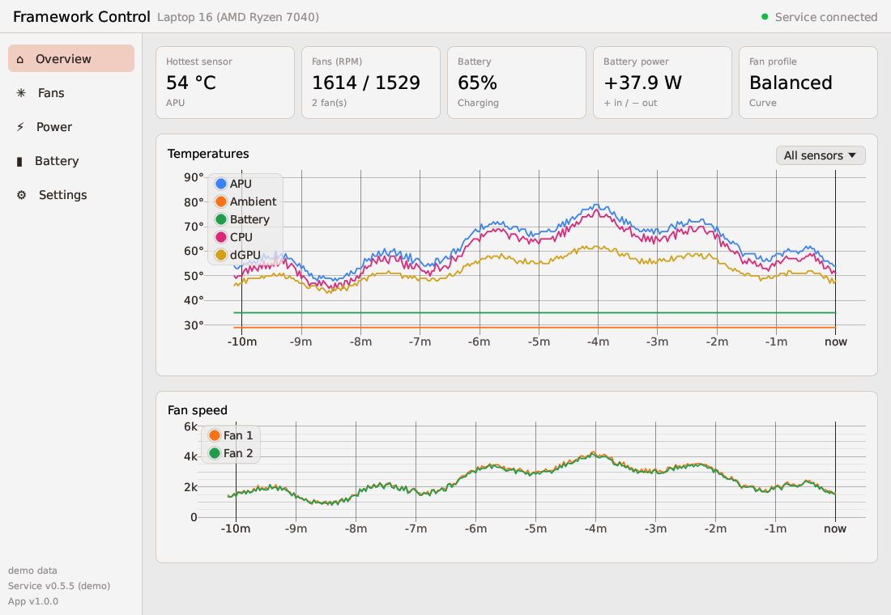
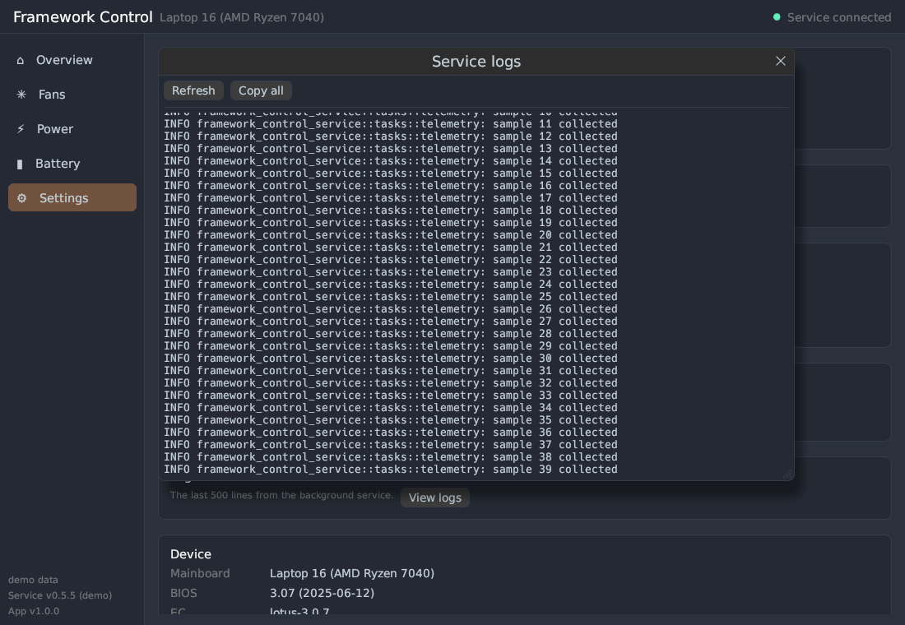

# Framework Control — Native Windows App

A native Windows desktop app for [Framework Control](https://github.com/ozturkkl/framework-control)
(fans, power and battery control for Framework laptops). It replaces the
browser-based UI with a lightweight Rust app, so you no longer need Chrome or
Edge running to use it.

**[⬇ Download the latest installer](https://github.com/kingof9x/framework-control-windows-naitive/releases/latest)**
(`FrameworkControl-<version>-x64.msi`)



## Resource savings

The upstream project opens its UI in Chrome/Edge "app mode". This fork keeps
the same background service but draws the UI natively with
[egui](https://github.com/emilk/egui), instead of loading a web page in
Chromium.

| | Native app (this fork) | Chromium app mode (upstream UI) |
|---|---|---|
| Memory (PSS, all processes) | **104 MB**, of which ~67 MB was the software GPU driver | **491 MB** |
| Processes | **1** | 10 |
| CPU time while idle, 30 s | **1.3 s** | 3.6 s |
| Browser required | **No** | Chrome or Edge |
| App download | **5.6 MB** single `.exe` | browser + web assets |

**About 4.7× less memory, 10× fewer processes, about 2.8× less idle CPU.**

<sub>How this was measured: both UIs showed the same live service on the same
machine (Linux, 1100×760 window, software OpenGL renderer since there was no
GPU), with memory summed as PSS across each UI's process tree. On a real
Windows laptop the GPU driver replaces the ~67 MB software renderer, so the
app's own footprint is closer to 30–40 MB. Absolute numbers will vary; the
ratio is the point. The background service is identical in both setups and
isn't counted.</sub>

The native app redraws only when new readings arrive (every 2 s by default)
or when you interact with it, and closing the window stops it entirely. The
service keeps applying your fan curves and power limits in the background.

## Screenshots

| Fans: curve editor with live duty markers | Per-fan overrides |
|---|---|
|  |  |
| **Battery: charge limits and history** | **Power: TDP and thermal limits** |
|  |  |
| **Settings: updates, themes, framework_tool** | **Calibration wizard** |
|  |  |
| **Light theme (all 8 web themes are supported)** | **Service logs** |
|  |  |

## What's in the port

Everything the upstream web UI does, natively:

- **Sensors**: live temperature and fan RPM graphs with a sensor filter, and a
  configurable sample interval.
- **Fans**:
  - Auto (EC), Manual and Curve modes.
  - Drag-to-edit curve: click to add points, right-click to remove.
  - Hysteresis, plus separate up and down rate limits.
  - Per-fan overrides.
  - Live duty markers once the fans are calibrated, with the calibration wizard built in.
- **Fan profiles**: create, rename, reorder and delete profiles, and switch
  automatically when you plug in or go on battery.
- **Power**:
  - Separate plugged-in and on-battery profiles.
  - TDP and thermal limits through RyzenAdj, which installs in one click from
    the app; EPP, governor and frequency limits on Linux.
- **Battery**: charge limit, charge-rate limit with an SoC threshold, health,
  cycles, live power, and up to 7 days of history.
- **Settings**: in-app updates, the 8 themes shared with the web UI,
  turning features on or off (this also stops their background work),
  `framework_tool` version switching, the service log viewer, and device info.

All settings live in the service's config, so they're shared with the web UI.
Both can be used side by side.

[`tools/parity/parity.toml`](tools/parity/parity.toml) lists every upstream
endpoint, web component and setting, and where it lives in the native app.
The few omissions are browser-only features, such as the hosted-page version
check and browser shortcut creation, and each one has a note explaining why.

## Install

1. Download `FrameworkControl-<version>-x64.msi` from the
   [latest release](https://github.com/kingof9x/framework-control-windows-naitive/releases/latest)
   and run it.
2. Open **Framework Control** from the Start Menu or Desktop.

The installer sets up the background service and the app, plus Start Menu and
Desktop shortcuts that open the app instead of a browser. If you already have
upstream Framework Control installed, this installer replaces it and keeps your
settings.

> ⚠️ **Framework 16:** BIOS 3.07 or newer is required for proper EC/fan control.
> Install the [latest BIOS](https://knowledgebase.frame.work/en_us/framework-laptop-16-bios-and-driver-releases-amd-ryzen-7040-series-BkeqkVovp) first.

A portable `framework-control-app-<version>-x64.zip`, containing just the app,
is also attached to each release. It works with any running Framework Control
service, including an upstream install.

### Updates

**Settings → Updates** checks this repository's
[GitHub releases](https://github.com/kingof9x/framework-control-windows-naitive/releases)
for a newer build. **Install** downloads the MSI and the service installs it
silently, without a UAC prompt, keeping your settings. Turn on **Automatically
keep up to date** to have the service check every 6 hours and install new
releases by itself. A badge in the app header also shows when an update is
available.

### Uninstall

Uninstall **Framework Control** from Settings → Apps. This removes the
service, the app, the shortcuts and the saved settings.

## How it works

```
┌──────────────────────────┐   HTTP on 127.0.0.1   ┌────────────────────────────┐
│ framework-control-app    │ ────────────────────▶ │ framework-control-service  │
│ native UI (Rust + egui)  │                       │ Windows service (SYSTEM)   │
│ only runs while open     │ ◀──────────────────── │ fan curves, power limits,  │
└──────────────────────────┘     JSON + config     │ battery, telemetry history │
                                                   └─────────────┬──────────────┘
                                                                 │ framework_tool / RyzenAdj
                                                                 ▼
                                                      Embedded controller / CPU
```

- `service/`: upstream's Rust service. The fork changes it only slightly: the
  update check can use a release version baked in at build time, and versions
  are compared numerically.
- `native/`: the desktop app. API calls happen on a background thread, so the
  window never blocks. Edits save automatically, like the web UI.
- `native/installer/`: the WiX MSI and `build-msi.ps1`.
- `web/`: upstream's Svelte UI. It isn't shipped here, but it's kept as the
  reference for feature parity.

## Staying in sync with upstream

Upstream keeps adding features, so the fork includes a parity tool. It's
built so Claude (or anyone else) can run the sync:

```bash
python3 tools/parity/parity.py upstream   # what changed upstream since the last sync, and what isn't ported
python3 tools/parity/parity.py check      # fail if any upstream endpoint/component/setting is unaccounted for
python3 tools/parity/parity.py mark-synced
```

CI runs `check` on every push. The step-by-step sync process (merge rules,
where each kind of change goes, how to release) is in the
[`upstream-parity` skill](.claude/skills/upstream-parity/SKILL.md). In Claude
Code, just ask it to "sync with upstream".

## Building from source

Requirements: Rust stable (MSVC on Windows). For the MSI, you also need WiX
Toolset v3 (`choco install wixtoolset`).

```bash
cd native
cargo run --release -- --demo     # sample data, no service or Framework laptop needed
cargo run --release               # connect to the local service (port from the install, $FRAMEWORK_CONTROL_PORT, or 8090)
cargo test
```

```powershell
pwsh native/installer/build-msi.ps1   # -> native/dist/FrameworkControl-<version>-x64.msi
```

Releases: bump `version` in `native/Cargo.toml` and add an entry to
`native/CHANGELOG.md`. Pushing to `main` builds the MSI and publishes the
GitHub release ([workflow](.github/workflows/native-release.yml)).
See [`native/README.md`](native/README.md) for app internals.

## Credits

Framework Control was created by [Kemal Ozturk](https://github.com/ozturkkl).
The service, the feature set and the original UI are theirs; this fork adds
the native front end and the Windows packaging. If you find it useful,
consider [supporting the upstream project](https://github.com/ozturkkl/framework-control).
MIT licensed (see [LICENSE](LICENSE)).

## Disclaimer

This software is provided "as is", without warranty of any kind, express or
implied. By using it, you acknowledge that you are responsible for any
configuration changes you make to your system and accept all risks associated
with its use. The authors and contributors are not liable for any damage, data
loss, hardware wear, unintended behavior, or other harm that may result from
use or misuse of this application.
